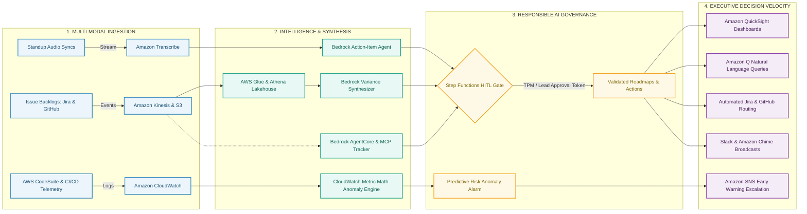

# AI & Workflow Automation – Project Management (AWS Edition)

An enterprise Technical Program Management (TPM) acceleration framework engineered to use AI to automate project management workflows. Built on Amazon Web Services (AWS) reference architectures, but the underlying ingestion, LLM synthesis, and governance patterns apply directly to Azure or any other enterprise cloud environment. This repository replaces traditional operational overhead—manual status spreadsheets, retrospective meeting notes, and reactive status chasing—with event-driven telemetry, automated executive synthesis, agentic dependency tracking, and predictive risk detection.

Authored by **David Maralack** (PMP, PMI-CPMAI, AWS Certified AI Business Strategist).

---

## 1. Operating Philosophy: Building Systems Instead of Chasing Status

In large-scale engineering organizations, traditional technical program management frequently degenerates into administrative maintenance: compiling weekly status decks, chasing engineers for updates, and capturing fragmented notes during stand-ups. This operating model introduces structural delivery risks:

*   **Reporting Lag:** Static status decks published on Fridays reflect issues that occurred days earlier, rather than surfacing blockers emerging next week.
*   **Engineering Administrative Tax:** Tech leads and engineering managers routinely lose three to five hours every week compiling manual variance summaries.
*   **Siloed Delivery Signals:** Pull-request review latency, ticket churn, and cross-team dependencies reside in separate repositories and issue trackers, obscuring critical-path risks until key delivery dates slip.

This repository operationalizes the **PMI-CPMAI (Cognitive Project Management for AI)** methodology and **AWS Cloud Adoption Framework**. It addresses five foundational questions for modern technical program delivery:

1.  **What information should be automated?** Routine operational data collection, stand-up action-item extraction, and backlog status aggregation.
2.  **What reporting can be generated instead of manually created?** Executive narrative variance reports, sprint burn-down summaries, and multi-team status briefs.
3.  **What signals predict future risk?** Pull-request turnaround delays, cross-repository ticket aging, and anomalous build failure rates.
4.  **What data should be surfaced before executives ask for it?** Critical-path dependency lags, capacity bottlenecks, and trade-off scenarios on scope versus schedule.
5.  **What decisions can be accelerated through AI and analytics?** Resource rebalancing across partner teams, scope descoping decisions, and automated bug triage.

---

## 2. Comparative Operational Model

The following matrix contrasts traditional manual program coordination against the automated, telemetry-driven operating model implemented in this architecture:

| Operational Dimension | Traditional Program Management | Automated AI & Telemetry TPM Operating Model | Quantifiable Business Impact |
| :--- | :--- | :--- | :--- |
| **Executive Status Reporting** | Manual status decks compiled every Friday from disparate team leads | Automated serverless data pipeline feeding Amazon Bedrock for executive variance synthesis | **80% reduction** in status preparation time (from hours to 10 minutes) |
| **Meeting Operations & Follow-ups** | Manual note-taking in open-ended meetings, leading to dropped action items | Amazon Transcribe speech-to-text pipeline parsing discussions into structured Jira/JSON tickets | **100% action-item capture** with zero post-meeting administrative lag |
| **Cross-Team Dependency Tracking** | Bi-weekly cross-functional sync meetings with manual dependency logs | Multi-agent backlog discovery using Model Context Protocol (MCP) and Step Functions HITL gates | Automated detection of unstated API and contract mismatches across repositories |
| **Delivery Risk & Milestone Tracking** | Reactive post-mortems conducted after milestone targets slip | Real-time Amazon CloudWatch anomaly detection on pull-request cycle times and ticket churn | **2 to 3 weeks earlier** risk identification prior to release milestone gates |
| **Data Architecture & Visibility** | Static, disconnected spreadsheets across individual teams | Centralized AWS Lakehouse (Glue, Athena, QuickSight) providing single source of truth | Elimination of redundant data reconciliation and subjective reporting |

---

## 3. High-Level Infographic Flow & Architecture

The architecture transforms unstructured operational noise—scattered tickets, lengthy stand-up discussions, and disparate commit streams—into verifiable executive decision velocity. It moves operational data through four interconnected stages with strict Human-in-the-Loop (HITL) checkpoints.

### Visual Infographic Architecture (GitHub Rendered)



### Infographic Flow: From Operational Noise to Executive Clarity

```
  ┌────────────────────────────────────────────────────────────────────────────────────────┐
  │                           STAGE 1: MULTI-MODAL INGESTION                               │
  │  Standup Audio ──► Amazon Transcribe (Domain Vocabularies & Speaker Diarization)       │
  │  Issue Logs    ──► Amazon Kinesis / S3 Lakehouse (Real-time Webhook Ingestion)        │
  │  CI/CD Churn   ──► Amazon CloudWatch (Commit Velocity & PR Turnaround Metrics)         │
  └──────────────────────────────────────────┬─────────────────────────────────────────────┘
                                             │
                                             ▼
  ┌────────────────────────────────────────────────────────────────────────────────────────┐
  │                        STAGE 2: AI SYNTHESIS & METRIC MATH                             │
  │  Action Extraction ──► Amazon Bedrock (Zero-Shot JSON Schema Parsing)                 │
  │  Variance Analysis ──► AWS Glue + Athena Lakehouse + Amazon Bedrock Synthesizer        │
  │  Dependency Audit  ──► Bedrock AgentCore + Model Context Protocol (Cross-Repo Backlog) │
  │  Anomaly Detection ──► CloudWatch Metric Math (Dynamic Statistical Expected-Bands)     │
  └──────────────────────────────────────────┬─────────────────────────────────────────────┘
                                             │
                                             ▼
  ┌────────────────────────────────────────────────────────────────────────────────────────┐
  │                      STAGE 3: RESPONSIBLE AI GOVERNANCE GATE                           │
  │  AWS Step Functions Human-in-the-Loop (HITL) Workflow Execution                       │
  │  ├── Programmatic Pause Token: Halts autonomous updates to production roadmaps         │
  │  ├── TPM / Tech Lead Review: 5-minute review of AI-synthesized narrative variance      │
  │  └── One-Click Verification: Approves task dispatch via Amazon SES / SNS callback     │
  └──────────────────────────────────────────┬─────────────────────────────────────────────┘
                                             │
                                             ▼
  ┌────────────────────────────────────────────────────────────────────────────────────────┐
  │                        STAGE 4: EXECUTIVE DECISION VELOCITY                            │
  │  Live Visibility   ──► Amazon QuickSight & Amazon Q (Self-Service Conversational BI)   │
  │  Delivery Rhythm   ──► Automated Slack & Amazon Chime Synthesis Broadcasts             │
  │  Action Execution  ──► Direct Jira & GitHub Milestone Issue Generation                │
  │  Proactive Defense ──► 2-to-3 Week Early Warning SNS Risk Notifications               │
  └────────────────────────────────────────────────────────────────────────────────────────┘
```

### Stage-by-Stage Operational Walkthrough

| Stage & Component | Primary AWS Services | Operational Input | TPM Output & Business Impact |
| :--- | :--- | :--- | :--- |
| **1. Multi-Modal Ingestion** | Amazon Transcribe, Amazon Kinesis, Amazon S3, CloudWatch | Unstructured meeting recordings, Jira/GitHub events, CI/CD telemetry | Centralized, query-ready operational data stream without manual reporting sheets |
| **2. Intelligence & Synthesis** | Amazon Bedrock, Bedrock AgentCore, AWS Glue, Amazon Athena | Multi-speaker transcripts, sprint burndown metrics, cross-repo API PRs | Automated JSON action items, cross-team dependency mapping, and 3-bullet variance summaries |
| **3. Responsible AI Governance** | AWS Step Functions, Amazon SNS, Amazon SES | AI-drafted milestone adjustments, unassigned tasks, narrative summaries | **Zero hallucination risk**; enforces human accountability and audit trails before updating master plans |
| **4. Executive Decision Velocity** | Amazon QuickSight, Amazon Q, Slack, Amazon Chime | Validated executive summaries, anomaly scores, approved tickets | **80% reporting time savings**; eliminates surprise slips with 2–3 week predictive warnings |

---

## 4. Implementation Modules

The implementation is partitioned into four modular, production-ready components that directly correspond to enterprise AI competencies:

### Module 1: Meeting & Standup Intelligence (`/01-meeting-intelligence`)
*   **Focus Area:** Automating meeting summaries, action items, and follow-ups.
*   **AWS Reference Lineage:** Adapted from `aws-samples/amazon-transcribe-post-call-analytics` and `aws-samples/amazon-bedrock-samples`.
*   **Technical Implementation:**
    *   **Amazon Transcribe:** Ingests recorded multi-speaker stand-ups and technical design syncs, applying custom domain vocabularies to handle internal engineering codenames, microservice architectures, and hardware acronyms.
    *   **Amazon Bedrock Structured Parsing:** Processes transcripts using high-fidelity prompts to extract clear action items formatted into strict JSON schemas:
        ```json
        {
          "action_items": [
            {
              "task": "Update authentication token validation schema",
              "assignee": "auth-infra-lead",
              "priority": "P1",
              "blocking_dependency": "API-Gateway-v2",
              "target_completion": "2026-11-20"
            }
          ]
        }
        ```
    *   **Automated Issue Creation:** An AWS Lambda function ingests the validated JSON payload and automatically generates linked Jira or GitHub issues with assigned owners and milestone tags.

### Module 2: Automated Executive Reporting & Variance Dashboards (`/02-executive-reporting`)
*   **Focus Area:** AI-driven project tracking, executive reporting, and live dashboard generation.
*   **AWS Reference Lineage:** Adapted from `aws-samples/generative-ai-document-summarization-on-aws` and `aws-samples/generative-ai-using-amazon-quicksight-and-amazon-bedrock`.
*   **Technical Implementation:**
    *   **Telemetry Aggregation (AWS Glue & Amazon Athena):** Queries historical sprint velocity, pull-request turnaround times, and open bug severity distributions across multiple team backlogs.
    *   **Narrative Synthesis (Amazon Bedrock & Amazon Q Business):** Generates structured, three-tiered executive briefing summaries:
        *   *Milestones Delivered:* Quantifiable sprint achievements tied directly to quarterly objectives.
        *   *Variance & Root Cause:* Objective breakdown of slipped tasks, separating vendor delays from technical discovery debt.
        *   *Strategic Decisions Required:* Actionable trade-offs presented to leadership regarding scope adjustments, resource reallocations, or accepted technical debt.
    *   **Executive Visualization (Amazon QuickSight):** Connects to the underlying Lakehouse to present real-time burndowns and risk distributions powered by Amazon Q in QuickSight, eliminating the need for manually formatted static status presentations.

### Module 3: Agentic Dependency Orchestration & Tool Governance (`/03-agentic-orchestration`)
*   **Focus Area:** Hands-on AI tool utilization and building AI-powered workflows with verified controls.
*   **AWS Reference Lineage:** Adapted from `aws-samples/amazon-bedrock-agent-samples`.
*   **Technical Implementation:**
    *   **Amazon Bedrock AgentCore & Action Groups:** Configures autonomous agents equipped with OpenAPI schemas to query disparate team repositories (e.g., client application repos versus core cloud infrastructure repos).
    *   **Model Context Protocol (MCP) & Amazon Q Developer:** Connects language model reasoning to external developer tooling, cross-referencing API contract pull requests in AWS CodeCommit/GitHub against delivery roadmap commitments.
    *   **Step Functions Human-in-the-Loop (HITL) Gate:** Ensures that autonomous agents cannot unilaterally alter production roadmap baselines. When an agent identifies a potential dependency clash, it drafts a mitigation proposal and halts execution until an authorized TPM reviews and approves the change via Amazon SNS/SES callback tasks.

### Module 4: Predictive Delivery Risk & Telemetry (`/04-predictive-risk-telemetry`)
*   **Focus Area:** Using predictive analytics and telemetry to identify delivery risks and blockers prior to milestone impact.
*   **AWS Reference Lineage:** Adapted from `aws-samples/cloudwatch-metric-math-anomaly-detection` and `aws-samples/aws-devops-guru-samples`.
*   **Technical Implementation:**
    *   **Dynamic Anomaly Detection:** Configures CloudWatch Metric Math algorithms over engineering telemetry, establishing dynamic expected-value bands for pull-request review turnaround, ticket re-opening rates, and unassigned blocker aging.
    *   **Adaptive Data Monitoring Framework:** Builds on telemetry monitoring principles and patented techniques (U.S. Patent #8,984,124: *System and Method for Adaptive Data Monitoring*) to filter noise and flag statistically meaningful delivery deceleration.
    *   **Proactive Warning Alerts:** Automatically notifies TPMs and engineering directors two to three weeks before scheduled release dates when upstream dependency churn indicates a high probability of delivery slip.

---

## 5. Repository Structure

```
ai-workflow-automation-pm/
│
├── README.md                                  # Executive summary, operating model & architecture
├── LICENSE                                    # MIT License
│
├── 01-meeting-intelligence/
│   ├── lambda_transcribe_handler.py           # Serverless audio ingestion and transcription trigger
│   ├── prompts/action_item_extractor.json     # Bedrock prompt template enforcing strict JSON output
│   └── tests/test_transcribe_pipeline.py      # Unit tests for domain vocabulary and extraction
│
├── 02-executive-reporting/
│   ├── glue_etl_sprint_metrics.py             # Serverless ETL aggregating sprint and PR telemetry
│   ├── bedrock_variance_summarizer.py         # Multi-tier executive narrative generation script
│   └── quicksight_manifest.json               # Visual dashboard dataset and schema mapping
│
├── 03-agentic-orchestration/
│   ├── openapi_pm_spec.json                   # OpenAPI 3.0 schema defining PM action group tools
│   ├── step_functions_hitl_workflow.asl.json  # ASL state machine definition with approval tokens
│   └── mcp_jira_connector.py                  # Model Context Protocol server connector
│
└── 04-predictive-risk-telemetry/
    ├── cloudwatch_anomaly_alarms.json         # Metric math alarm definitions for delivery metrics
    └── risk_scoring_pipeline.py               # CPMAI predictive risk scoring and notification logic
```

---

## 6. Technology Stack & Frameworks

*   **Cloud Infrastructure & Serverless:** Amazon Web Services (AWS) — Amazon Bedrock, AWS Lambda, AWS Step Functions, Amazon Transcribe, Amazon CloudWatch, Amazon QuickSight, AWS Glue, Amazon Athena, Amazon S3, Amazon Kinesis, Amazon SNS, Amazon SES.
*   **Generative AI & Enterprise Assistants:** Amazon Q Developer, Amazon Q Business, Anthropic Claude (via Amazon Bedrock), Amazon Titan, Bedrock AgentCore, Model Context Protocol (MCP), LangChain.
*   **CI/CD & Delivery Systems:** AWS CodePipeline, AWS CodeBuild, AWS CodeCommit, Jira Software, GitHub, Slack, Amazon Chime.
*   **Business Intelligence & Telemetry:** Amazon QuickSight (Executive dashboards & Amazon Q in QuickSight narrative summaries), Amazon CloudWatch Metric Math.
*   **Governance & Program Frameworks:** Project Management Professional (PMP)®, PMI Certified Professional in Managing AI (PMI-CPMAI), AWS Well-Architected Framework, AWS Cloud Adoption Framework.

---

## 7. Professional Background & Attribution

**David Maralack**  
*Senior Technical Program Manager & Enterprise AI Specialist*  
Seattle, WA | [LinkedIn Profile](https://linkedin.com/in/david-maralack-3898135) | [GitHub Profile](https://github.com/maralackdavid)

*   **Enterprise Track Record:** Over two decades of proven leadership orchestrating large-scale software and hardware platforms at **Amazon** (Kindle, Alexa, Customer Support Operations) and **Microsoft** (Windows, Bing, Anti-Piracy Licensing Telemetry).
*   **Intellectual Property:** Co-inventor, **U.S. Patent #8,984,124** (*System and Method for Adaptive Data Monitoring*) and **U.S. Patent #8,683,579** (*Software Activation Using Digital Licenses*).
*   **Industry Credentials:** Certified Project Management Professional (PMP)®, PMI Certified Professional in Managing AI (PMI-CPMAI), AWS Certified AI Business Strategist.
